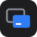
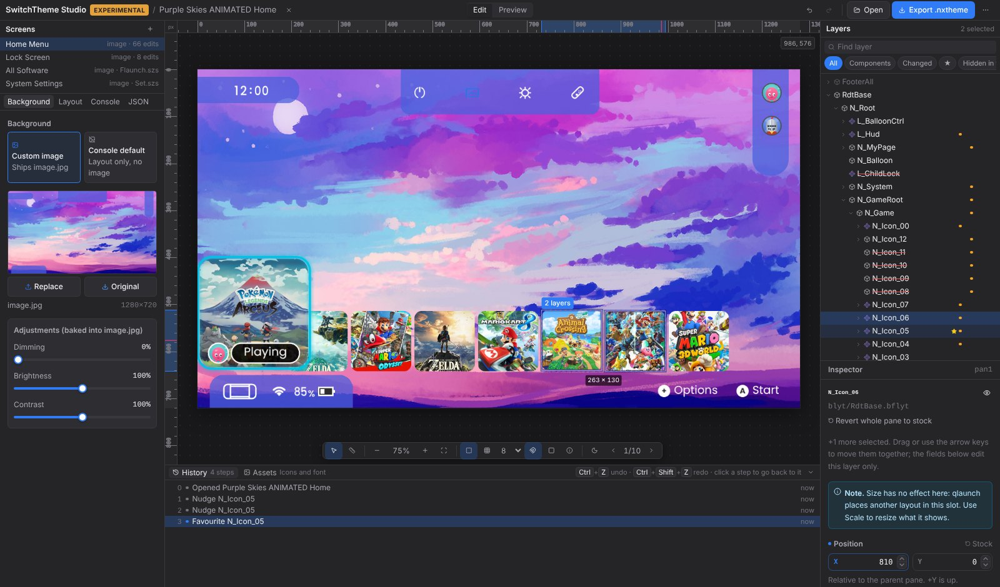
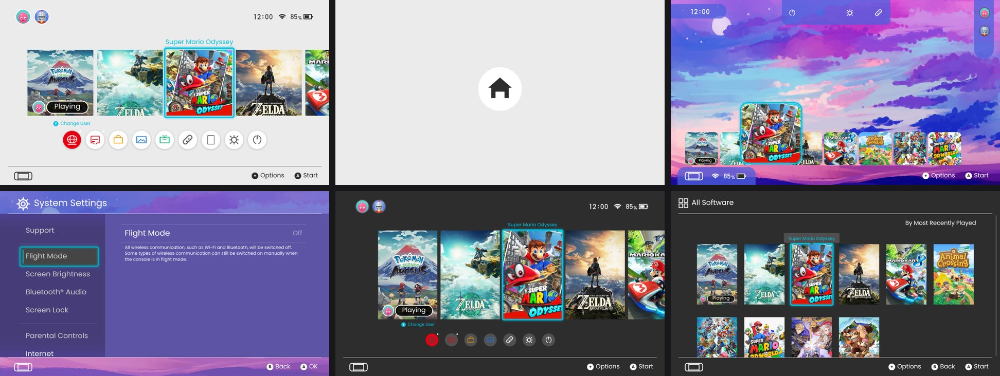
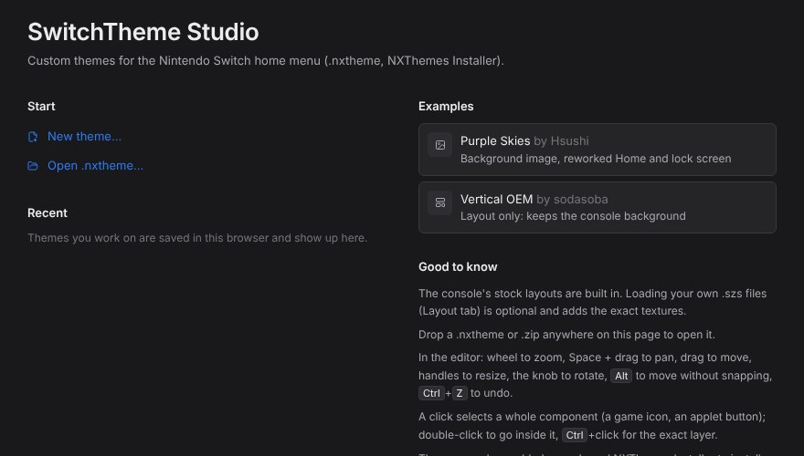
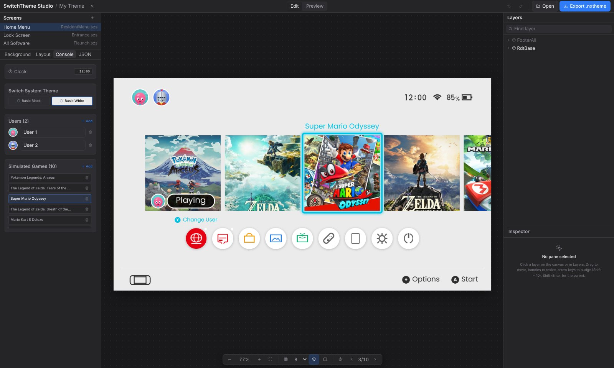
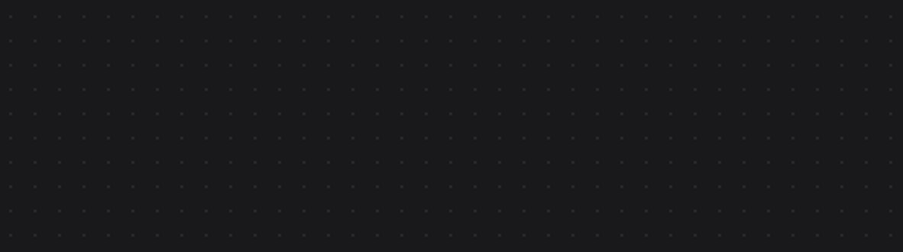
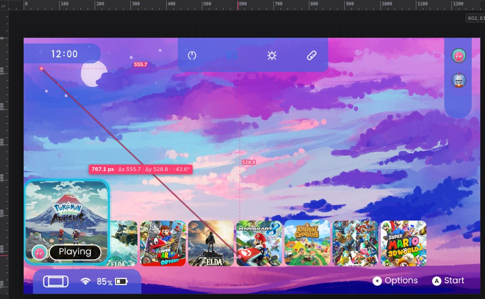
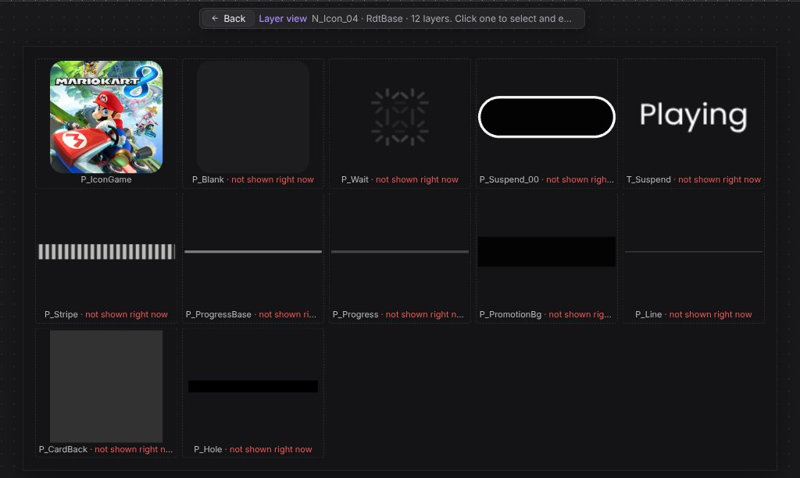
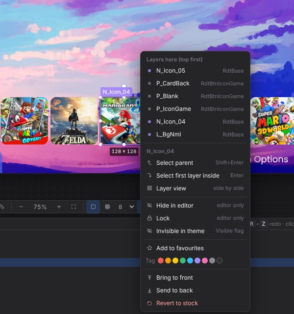

<p align="center">
  
</p>

<h1 align="center">SwitchTheme Studio</h1>

<p align="center">
  Create, edit and preview Nintendo Switch custom themes (<code>.nxtheme</code>) in the browser,<br />
  with a console-accurate live preview of every screen.
</p>

<p align="center">
  
  
  
  
  
</p>

<p align="center">
  
</p>

SwitchTheme Studio is a viewer, editor and creator for themes in the format used by
[SwitchThemeInjector / NXThemes Installer](https://github.com/exelix11/SwitchThemeInjector). It renders
the console's real layout files and applies a theme the same way the installer does, so what you see
in the browser is what the console shows. Nothing needs to be installed and nothing leaves your
browser.

> [!WARNING]
> **Experimental.** This project is still a work in progress: the preview is built to match the
> console but can be wrong, so test every theme on your console before sharing it.
> Installing custom themes requires a console running custom firmware and NXThemes Installer, at your
> own risk (warranty, online bans). This project is not affiliated with or endorsed by Nintendo.
> If a theme leaves you with a black screen or a crashing Home menu, see
> [If something goes wrong](#if-something-goes-wrong).

## Contents

- [Highlights](#highlights)
- [Screens](#screens)
- [Getting started](#getting-started)
- [Using the studio](#using-the-studio)
- [Console layouts](#console-layouts)
- [layout.json support](#layoutjson-support)
- [Project structure](#project-structure)
- [Development](#development)
- [Known limitations](#known-limitations)
- [If something goes wrong](#if-something-goes-wrong)
- [Disclaimer](#disclaimer)
- [Acknowledgements](#acknowledgements)

## Highlights

- **Console-accurate preview.** Renders the actual pane trees of firmware 20.0+ (built from 23.0.1):
  anchors, parts, materials, blend masks, user-data borders and rounded corners, idle animation
  states and what qlaunch lays out in code (game rows, the "Playing" balloon and title bubble, the
  status bar, the All Software list, the User page menu, the lock screen's two states).
- **No dump needed.** The stock layouts ship as structure and numbers only, with our own stand-in
  icons. They match a real 23.0.1 dump file for file and pane for pane; loading your console's
  `.szs` files is optional and adds the exact textures.
- **Figma-style editor.** Game icons, applet buttons and settings rows are components: one click
  selects the whole thing, double-click goes inside. Drag with smart guides, equal-spacing snapping
  and a snap grid, resize (components scale as a whole), rotate with the knob, nudge with the arrow
  keys, and undo everything, including editor-only hide and lock.
- **Precision tools.** Rulers in console pixels with the selection and cursor marked, a measure tool
  (point A to point B: distance, Δx, Δy and angle, snapping to edges and centres), and live
  readouts while moving, resizing, scaling and rotating (with an arc and the angle in degrees).
- **Multi-select and a layer menu.** <kbd>Ctrl</kbd>/<kbd>Shift</kbd>+click or a selection box, move and nudge
  them together. Right-click lists every layer under the cursor and offers hide/lock (editor),
  visible/invisible (theme), favourites, colour tags, draw order, revert and Layer view.
- **Layer view.** Lays every layer of a component out side by side (the icon, its highlight, the
  pressed and suspended states…) so you can pick and edit the one you want.
- **Organised layers.** Filters for components, changed, hidden in theme, hidden, locked,
  favourites and colour tags. A component's layers are hidden and locked with it.
- **Meaningful outlines.** Colour says what a layer is (component, changed, hidden in the theme,
  locked); solid, dashed and dotted lines say whether it is selected, hovered or not drawn. A legend
  is one click away.
- **History panel.** Every step is labelled ("Move N_Icon_04", "Hide P_Bg in theme"); click one to
  go back to it, like a paint program.
- **Cautions where the console disagrees.** When qlaunch overrides a value at runtime (the status
  bar row, the User page menu, title balloons, a part's RootPane…) or a patch can't work on the
  firmware, the Inspector, the drag readout and the layer menu say so.
- **Style editing, not just layout.** Vertex and text colours, material colours, the system palette
  colours qlaunch reads from user data (`C_W` / `C_B`), rounded corners and borders, draw order,
  and custom applet and lock icons (fitted to the installer's required size), all written to
  `layout.json` the way the installer reads them.
- **Installer-exact patching.** Every `layout.json` feature SwitchThemesCommon applies is applied
  here too: custom icons (`album.png` … `lock.png`), theme animations and the installer's ten
  compatibility fixes for the target firmware. Tested with community packs (Vertical Blue Lava
  Lamp, Project Clean, PS5 Theme) as well as the examples.
- **Compatibility check.** Lists what a theme patches that isn't on the firmware (usually layouts
  written for an older one) and flags animations the installer would drop.
- **Live preview mode.** Use the screen like the console: move focus between games, switch Basic
  White / Basic Black, change users and their pictures, games and the clock, and choose whether a
  game is suspended. Player select opens over the blurred Home menu, as on the console.
- **Projects saved locally.** Themes autosave to IndexedDB and appear under Recent on the start page.
- **One-click export** of a screen (`.nxtheme`) or the whole theme (`.zip`), ready for NXThemes Installer.

## Screens

<p align="center">
  
  <br />
  <sub>As rendered by the studio. Top: stock Home and lock screen (Basic White), Purple Skies' Home menu. Bottom: Purple Skies' System Settings, Vertical OEM's Home menu and All Software (Basic Black).</sub>
</p>

<table>
  <tr>
    <td width="50%"></td>
    <td width="50%"></td>
  </tr>
  <tr>
    <td align="center"><sub>Start page: new theme, open, recent projects, examples</sub></td>
    <td align="center"><sub>Console tab: users and profile pictures, games, clock, Basic White / Black</sub></td>
  </tr>
</table>

Supported screens: **Home menu**, **Lock screen**, **All Software**, **System Settings**, **News**,
**User page** and **Player select**.

## Getting started

Requirements: [Node.js](https://nodejs.org/) 20.19+ or 22.12+.

```bash
git clone https://github.com/HanazonoArchive/switchtheme_studio.git
cd switchtheme_studio
npm install
npm run dev
```

Open the URL Vite prints (usually `http://localhost:5173`). To build a static site:

```bash
npm run build      # outputs to dist/
npm run preview    # serves the build locally
```

## Using the studio

### 1. Start or open a theme

The start page offers:

- **New theme**: start from the console's stock layout or from the Vertical OEM layout, and pick the
  screens to include.
- **Open .nxtheme**: open one or more themes (or a `.zip` of them). You can also drop files anywhere
  on the page.
- **Recent**: reopen themes saved in this browser.
- **Examples**: Purple Skies (image theme) and Vertical OEM (layout-only theme).

### 2. Edit

| Action | How |
|---|---|
| Select a layer | Click it on the canvas or in **Layers**. Components (a game icon, an applet button, a settings row) are selected whole, so moving one moves everything in it |
| Go into a component | Double-click it; clicks then pick at that level. Or use **Layer view** (grid button in Layers, or right-click) |
| Select parent / first child | <kbd>Shift</kbd>+<kbd>Enter</kbd> / <kbd>Enter</kbd> |
| Pick the exact layer under the cursor | <kbd>Alt</kbd>+click, or right-click for the list of every layer there |
| Select several | <kbd>Ctrl</kbd>/<kbd>Shift</kbd>+click adds or removes; <kbd>Ctrl</kbd>+drag, or a drag from empty canvas, draws a selection box |
| Layer menu | Right-click a layer on the canvas or in Layers |
| Measure | <kbd>M</kbd>, then drag from A to B (<kbd>Alt</kbd>: no snapping, <kbd>Shift</kbd>: 45°, <kbd>Esc</kbd>: clear). <kbd>V</kbd> goes back to selecting |
| Rulers | <kbd>Shift</kbd>+<kbd>R</kbd> |
| Number fields | Drag the label to scrub, hold the arrows, wheel while focused, <kbd>↑</kbd>/<kbd>↓</kbd> (<kbd>Shift</kbd> ×10) |
| Move | Drag (snaps to other layers, the screen and equal spacing between neighbours). <kbd>Alt</kbd> moves freely, <kbd>Shift</kbd> locks an axis |
| Resize | Drag a handle. <kbd>Shift</kbd> keeps the ratio. A component scales as a whole, with everything in it |
| Rotate | Drag the round knob above the selection. <kbd>Shift</kbd> snaps to 15° |
| Nudge | Arrow keys (<kbd>Shift</kbd> = 10 px) |
| Zoom / pan | Wheel zooms around the cursor, <kbd>Shift</kbd>+wheel pans, <kbd>Space</kbd>+drag or drag empty space pans, double-click fits |
| Undo / redo | <kbd>Ctrl</kbd>+<kbd>Z</kbd> / <kbd>Ctrl</kbd>+<kbd>Y</kbd>, including hiding and locking layers |
| Deselect | <kbd>Esc</kbd> (also leaves Layer view and clears a measurement) |

<p align="center">
  
  <br />
  <sub>Equal-spacing snap: the button lands 80 px from both neighbours.</sub>
</p>

<table>
  <tr>
    <td width="50%"></td>
    <td width="50%"></td>
  </tr>
  <tr>
    <td><sub>Measure (<kbd>M</kbd>): distance, legs and angle, snapping to edges and centres, with rulers in console pixels.</sub></td>
    <td><sub>Layer view: every layer of a component side by side, including the ones not shown right now.</sub></td>
  </tr>
</table>

<p align="center">
  
  <br />
  <sub>Right-click: every layer under the cursor, then what you can do with the selection.</sub>
</p>

Panels:

- **Screens** (left): the screens in the theme, with their edit counts.
- **Background / Layout / Console / JSON** tabs: the theme image and adjustments, the layout,
  installer fixes and compatibility, the preview's simulated console state, and the raw `layout.json`.
- **Layers** (right): the full hierarchy, including parts and the layouts the console creates in
  code. Components have a violet icon, changed panes an amber dot, panes hidden in the theme a red
  strike-through. Filter by components, changed, hidden, locked, favourites or colour tag. The eye
  and lock only affect the editor (and are undoable); a component's layers follow it. Right-click
  for the layer menu (Visible / Invisible in the theme, favourites, tags…).
- **Inspector** (right): position, size, scale, rotation, anchors and visibility of the selected pane;
  colours (vertex or text), its material's colours, system palette colours, corner radius and
  border, and draw order. Changed values are marked and each section reverts to stock.
- **History** (bottom dock): every step with its label and time; click one to go back to it.
- **Assets** (bottom dock): custom icons for the Home menu and lock screen (`album.png` …
  `share.png`, `lock.png`; any picture is fitted to the size the installer requires) with the
  console's icons as the default, and a preview font (TTF/OTF/WOFF) with Nunito Sans as the
  default stand-in. Fonts can't go into an `.nxtheme`, so the font is preview only.
- **⋯ menu** (top right): Help, troubleshooting, shortcuts, the outline legend, GitHub links and the
  disclaimer.

### 3. Preview

Switch the top bar to **Preview** to use the screen like the console: click a game or use the arrow
keys to move focus. The canvas toolbar switches between Basic White and Basic Black and steps through
the games. The **Console** tab sets the clock, users and their pictures, the games, and whether a
game is suspended (on the lock screen this switches between the centred HOME button and the
Continue layout with the status bar).

### 4. Export

**Export .nxtheme** downloads the current screen as an `.nxtheme`, or every screen as a theme pack
(`.zip`). Copy the files to `sd:/themes/` and install them with NXThemes Installer.

**Theme types**

- **Custom image**: ships `image.jpg` (1280×720, baseline JPEG) or a DXT1 `image.dds`.
- **Console default**: layout only; the console keeps its Basic White / Basic Black background.

## Console layouts

The stock layouts are built in (`public/stock/*.json`). They hold the pane trees, sizes, anchors,
colours, idle animation values and, for each texture, a short description: a colour, a gradient, a
rounded shape, or where the console's picture sits in its frame. They contain no Nintendo files or
pixels. Icons are the studio's own drawings, fitted onto the console's footprint so they line up.
The pack was generated from firmware 23.0.1, and the Layout tab shows that version.

Textures only change how things look, never where they sit: rendering the community packs with the
built-in pack and with a real dump gives the same layout to the pixel.

For an exact check with the console's own textures, load your files in **Layout → Console layout** or
drop a `.szs` on the canvas. In NXThemes Installer choose **Extract home menu → Extract szs layout
files**, then copy:

```
sd:/themes/systemData/extracted/qlaunch/lyt/*.szs
sd:/themes/systemData/extracted/mypage/lyt/*.szs
sd:/themes/systemData/extracted/playerselect/lyt/*.szs
```

The files stay in your browser. Don't commit or share them (`*.szs` is gitignored).

To regenerate the built-in pack from a dump (for a new firmware):

```bash
npm run build:stock -- path/to/extracted
```

## layout.json support

The preview applies everything the installer (SwitchThemesCommon) applies, in the same order:

| Feature | Notes |
|---|---|
| Pane patches | `Position`, `Rotation`, `Scale`, `Size`, `Visible`, origins and parent origins. A partial vector sets missing axes to 0, as in the installer, and the studio warns about it |
| Colours | `ColorTL`…`ColorBR`: vertex colours on pictures, font colours on text panes (editable) |
| `UsdPatches` | User data, with the injector's type and count rules: palette colours, `S_RoundRadius`, borders (editable) |
| `Materials` | `ForegroundColor` / `BackgroundColor` (editable), texture wrap (`Refs`) and `Transforms` |
| `PullFrontPanes` / `PushBackPanes` | Draw order within the parent (editable: Bring to front / Send to back) |
| `PatchAppletColorAttrib` | Home applet icons read from their alpha channel |
| `Anims` | The theme's animations, shown at their resting state (texture-scroll tracks too); not editable yet |
| Custom icons | `album.png` … `share.png`, `lock.png` (editable), with the installer's icon patches |
| Compatibility fixes | The installer's per-firmware fixes, chosen from `TargetFirmware` |

## Project structure

```
src/
  App.tsx                 app state, selection, layer menu, keyboard shortcuts, autosave
  features/
    canvas/               PixiJS renderer (PixiView), the editing overlay (selection, marquee,
                          measure, readouts) and shared geometry (outlines, Layer view)
    editor/               top bar, screens, tabs, layers, inspector, viewport and rulers,
                          bottom dock (history, assets), context menu, help
    project/              start page and export
  lib/
    nx/                   Switch formats: SARC, Yaz0, BFLYT, BFLAN, BNTX, ASTC
    layout/               layout.json model, patching, installer fixes, animation states,
                          palette, blend masks, textures
    render/               scene graph (world matrices, runtime content), mock drawing
    stock/                built-in layout pack and stand-in icon drawings
    theme/                .nxtheme read/write, background images
    state/                undo history (labelled steps), project storage
    editor/               layer marks (favourites, colour tags)
  lib/layout/limits.ts    what the console overrides at runtime (Inspector cautions)
  lib/compat.ts           browser feature check (banner when something is missing)
public/
  stock/                  built-in console layouts (generated)
  avatars/                original profile pictures for the preview
  demos/                  example themes
scripts/build-stock-pack.ts
tests/                    vitest suites and fixtures
docs/                     engineering notes and screenshots
```

## Development

| Command | What it does |
|---|---|
| `npm run dev` | Start the dev server |
| `npm test` | Run the test suite (parsers, patching, installer fixes, scene, export) |
| `npm run lint` | Lint with oxlint |
| `npm run build` | Type-check and build for production |
| `npm run build:stock -- <dir>` | Regenerate `public/stock` from an extracted dump |

How the renderer and patcher work, and what was learned matching real console screenshots, is in
[docs/engineering-notes.md](docs/engineering-notes.md).

## Known limitations

- UI strings come from the console's message files, which aren't included; the preview uses English
  stand-ins.
- Animations are shown at their resting state, not played.
- Some content is laid out by code on the console (All Software rows, Settings pages, news cards,
  the status bar, the lock screen's state); the preview reproduces it from the real layouts and
  console screenshots. Several of those screenshots come from older firmware, so a few rules are
  inferred; see [docs/engineering-notes.md](docs/engineering-notes.md).
- Built from firmware 23.0.1. Other firmware versions haven't been tested.
- A theme can only change panes that exist; it can't add new ones (a limit of the theme format).
- The preview font is session-only and isn't part of the theme (the `.nxtheme` format has no font).
- Needs a current browser with WebGL (Chrome/Edge 111+, Firefox 128+, Safari 16.4+). Missing
  features are listed in a banner.

## If something goes wrong

A theme only changes files on the SD card, and only while custom firmware runs, so a black screen or a
Home menu that crashes on boot is fixed by removing the theme's files:

1. Turn the console off and put the SD card in a computer (or use Hekate's USB tools / TegraExplorer).
2. In `sd:/atmosphere/contents/` (`sd:/atmosphere/titles/` on Atmosphère 0.9.4 and older) delete the
   folder of the screen that broke: `0100000000001000` (Home menu, lock screen, All Software,
   Settings, News), `0100000000001013` (User page), `0100000000001007` (Player select), or
   `0100000000000811` (a custom font). To keep other mods for that title, delete only its
   `romfs/lyt` folder.
3. Boot again. The console uses its own layout.

Firmware updates often break installed themes (lock screen themes most of all). Afterwards, update
NXThemes Installer, let it fetch its patches, extract the Home menu again and reinstall themes one at
a time. The same steps are in the studio under **⋯ → If something goes wrong**.

## Disclaimer

SwitchTheme Studio is an unofficial, experimental fan project, provided "as is" without warranty of
any kind. The authors aren't responsible for damage, data loss, bans or other consequences of using it
or the themes made with it. It is not affiliated with, endorsed or sponsored by Nintendo; Nintendo
Switch is a trademark of Nintendo. The studio ships no Nintendo files; layouts loaded from your console
stay in your browser and are never exported. Don't share your console's `.szs` or other system files.

## Acknowledgements

- [exelix11/SwitchThemeInjector](https://github.com/exelix11/SwitchThemeInjector): the theme format,
  installer behaviour and layout documentation this project follows.
- Example themes from [Themezer](https://themezer.net/): *Purple Skies* by Hsushi and *Vertical OEM*
  by sodasoba, with layouts by FairTech and others.
- Nintendo Switch is a trademark of Nintendo. Game titles and cover art shown in the preview belong
  to their respective owners.
